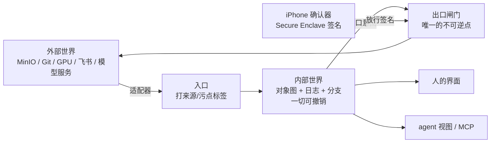
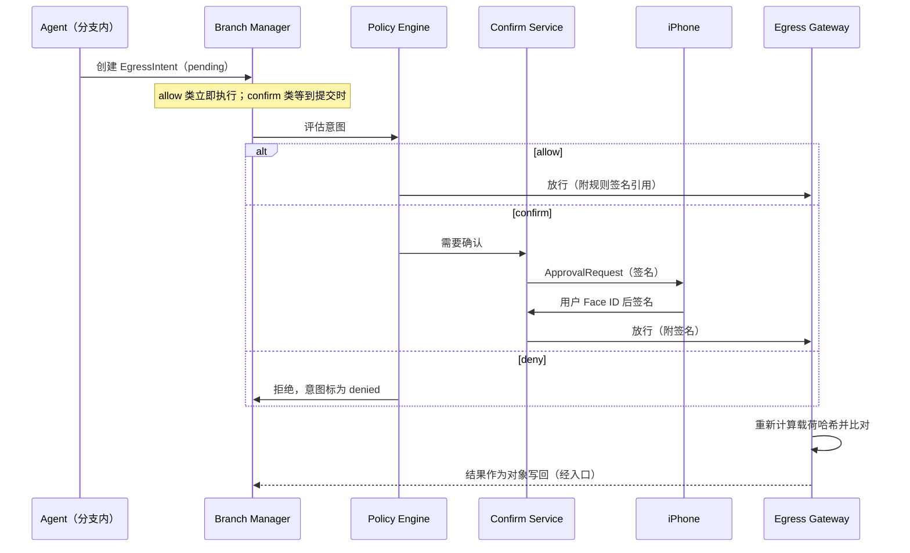

# AOS 需求文档（Linux 版）

> 代号 **AOS**（agent-native OS）：在 Linux 内核之上建立独立的 AOS 世界，开机直接进入，运行在 QEMU 中。
>
> 本文件是本仓库唯一的规格，自成一体，不依赖任何其他仓库或文档。第一部分规定系统语义，第二部分规定平台实现。

---

# 第一部分：系统语义

## 0. 给实现 agent 的读法

- 关键词 MUST（必须）、SHOULD（应当）、MAY（可以）含义同 RFC 2119。
- 先完整读第一部分（系统语义），再读第二部分（平台实现）。第二部分不得改写第一部分的语义。
- 本文件没有规定的细节：选最简单的实现，并在仓库根目录 `DECISIONS.md` 里追加一行：`日期 | 决定 | 理由 | 是否可逆`。
- 发现本文件内部矛盾：在 `QUESTIONS.md` 记录，选择**更保守**（更少权限、更多可撤销）的一方继续。
- 每个里程碑以验收测试通过为完成标准，而不是代码写完。
- 任何测试都不得绕过出口闸门（§11）。需要模拟外部世界时，使用声明过的测试适配器。

---

## 1. 一句话

今天的软件把真实状态锁在应用内部，对外只给一张画（屏幕）。AOS 让操作系统掌管真实状态（**对象图**），以及所有可执行动作的说明书（**动作目录**）。人看渲染出来的界面，agent 看结构化的查询结果，两者改的是同一份数据。内部的一切修改都可撤销；不可逆只发生在**出口**，出口只有人能放行，放行签名来自用户 iPhone 的安全芯片。

---

## 2. 设计原则

| 编号 | 原则 | 含义 |
|---|---|---|
| P1 | 一份数据，两种画法 | 人和 agent 读写同一个对象图。任何组件都不持有私有业务状态。 |
| P2 | 内部一切可撤销 | 所有状态变更都是只追加日志里的事务。撤销 = 追加一个反向事务，日志永不删改。 |
| P3 | 不可逆只发生在出口 | 发送、付款、上传、对外披露数据（**包括发给云端模型**）只能经由出口闸门。 |
| P4 | 人的同意来自 agent 碰不到的地方 | 放行签名只能由用户 iPhone 的 Secure Enclave 产生，系统内任何组件都伪造不了。 |
| P5 | 外来内容是数据，不是指令 | 只有用户直接输入的意图是指令。外部内容带污点标签，一路追踪到出口。 |
| P6 | 能力而非身份 | agent 只持有任务级、可过期、有上限、只能衰减的能力令牌。 |
| P7 | 简洁 | 三个界面、一个确认动作、尽量少的概念。新增概念前，须在 `DECISIONS.md` 里论证它无法由现有概念组合出来。 |

---

## 3. 非目标（明确不做）

- 不兼容任何现有应用二进制，不运行传统 GUI 应用。
- 没有"应用""窗口""文件夹""桌面图标"这些概念。
- agent 不读像素、不使用屏幕坐标；系统里**不存在**截图 API。
- 没有按应用弹出的权限对话框。
- 不向用户或 agent 暴露 shell 和 POSIX 文件系统（系统内部使用 Linux，但这是实现细节）。
- v1 不做：多用户、多设备同步、语音与注视输入、手机形态、通用消费场景（购物、社交、支付）。

---

## 4. 术语

| 中文 | 英文标识 | 定义 |
|---|---|---|
| 对象 | Object | 带类型、带版本的数据单元，见 §6.1 |
| 类型 | Type | 对象的模式声明，含字段、关系、默认视图提示 |
| 对象图 | Object Graph | 所有对象及其引用关系的集合 |
| 日志 | Log | 只追加、哈希链接的事务序列，是唯一的真实来源 |
| 事务 | Transaction (tx) | 一组原子的对象写入 |
| 分支 | Branch | 从某个日志位置分叉出的写时复制视图；`main` 代表现实 |
| 变更单 | Diff | 分支相对其基点的语义差异，含待执行的出口意图 |
| 动作 | Action | 带声明（效果、可逆性、前置条件、代价、所需能力）的操作 |
| 动作目录 | Action Catalog | 所有已注册动作的声明集合，可被人和 agent 查询 |
| 提供方 | Provider | 注册一组类型和动作的软件包，取代"应用" |
| 能力令牌 | Capability | 授权调用某些动作、在某些上限内的不可伪造令牌 |
| 常设规则 | Standing Policy | 用户用 iPhone 签过一次、长期有效的出口放行规则 |
| 入口 | Ingress | 外部数据进入对象图的唯一路径 |
| 出口 | Egress | 对外产生效果的唯一路径 |
| 出口意图 | EgressIntent | 一个待执行的对外效果，作为对象存在于分支中 |
| 确认器 | Confirmer | 产生放行签名的设备；v1 是用户的 iPhone |
| 污点 | Taint | 标记数据来自外部、不可信 |
| 来源 | Provenance | 对象由谁、从哪里、基于哪些对象产生 |
| 视图镜头 | Lens | 某类型对象给人看时的声明式渲染规格 |
| 任务 | Task | agent 的一次工作单元 = 意图 + 分支 + 能力 + 记录 |
| 适配器 | Adapter | 把一个外部系统翻译成入口对象和出口通道的提供方 |
| 作业 | Job | 长时间运行的计算（如训练），有状态机和代价记账 |

---

## 5. 总体架构

### 5.1 三区模型



### 5.2 组件

| 组件 | 职责 | 是否属于可信计算基（TCB） |
|---|---|---|
| Log & Branch Manager | 日志、事务、分支、合并、撤销 | 是 |
| Object Store | 对象读写、索引、Blob 存储 | 是 |
| Type Registry | 类型注册与演进 | 是 |
| Capability Service | 签发、衰减、校验能力令牌 | 是 |
| Policy Engine | 评估出口意图：自动放行 / 需确认 / 拒绝 | 是 |
| Egress Gateway | **唯一**能对外写或对外发送数据的组件 | 是 |
| Confirm Service | 与 iPhone 配对、发出审批请求、验证签名 | 是 |
| Action Runtime | 在沙箱里执行动作，强制效果声明 | 是（沙箱部分） |
| Ingress Gateway | 接收适配器数据，打标签 | 是 |
| Query Engine | 对象图查询 | 否 |
| Job Supervisor | 长任务调度、代价记账 | 否 |
| Agent Host | 运行 agent 任务，调用模型 | **否**（视为不可信） |
| View Server | 给人渲染界面 | **否**（屏幕视为不可信） |
| Adapters / Providers | 领域类型、动作、外部翻译 | **否** |

规则：非 TCB 组件被攻破（例如 agent 被提示注入）时，最坏结果只能是**在分支里制造错误的内部修改**（可撤销，并且在变更单里可见），以及在用户签过的常设规则上限之内触发出口（§9.3）。非 TCB 组件**不能**产生任何未经 iPhone 签名授权的不可逆效果。

aos-view 是唯一能以 `user` 身份写入的组件（§A9）。它被攻破时，还可以在 `main` 上以 `user` 身份做内部修改、创建任务；这些同样可撤销，出口同样受上面的约束。

---

## 6. 数据模型

### 6.1 对象

```json
{
  "id": "01JC8Z3K9Q6V2X4M7N1P0R5T8W",
  "type": "ml/DatasetVersion@1",
  "version": 1,
  "fields": {
    "dataset": {"ref": "01JC8Z..."},
    "number": 13,
    "parent": {"ref": "01JC8Y..."},
    "members": {"blob": "sha256:9f2c..."},
    "sample_count": 48213,
    "note": "去重后"
  },
  "provenance": {
    "actor": "agent:task/01JC90...",
    "origin": "internal",
    "taint": "external",
    "derived_from": ["01JC8Y...@1"],
    "tx": "01JC91..."
  },
  "sensitivity": "internal",
  "extra": {},
  "tombstone": false
}
```

- `id`：ULID，全局唯一，不可变。
- `version`：每次写入加 1，用于乐观并发和冲突检测，不承载业务含义。业务上的版本号（例如数据集的第几版）用独立字段表示（§15.2）。
- `provenance.actor`：`user`、`agent:task/<id>`、`adapter:<name>`、`system` 之一。人和 agent 都只是不同的 actor，**人的编辑同样记入日志、同样可撤销**。
- `provenance.taint`：`clean` 或 `external`。由入口设置，并按 §10 传播。本例派生自导入的样本，因此带污点。
- `sensitivity`：`public | internal | private | secret`。用户数据默认 `private`。
- `extra`：允许存放类型未声明的字段（松散类型，见 §6.5）。
- `tombstone`：为 `true` 表示该版本是删除标记（§6.3）。
- 对象引用的 blob 就是字段中 `blob` 类型的值，不另设列表；blob 回收以此为准（§6.4）。

### 6.2 类型

```yaml
type: ml/DatasetVersion
major: 1
fields:
  dataset:      { ref: ml/Dataset, required: true }
  number:       { int: {min: 1}, required: true }
  parent:       { ref: ml/DatasetVersion }
  members:      { blob: {}, required: true }
  sample_count: { int: {min: 0}, required: true }
  note:         { text: {max: 2000} }
relations:
  children: { many: ml/DatasetVersion, via: parent }
view_hint:
  title: "{dataset.name} v{number}"
  primary_fields: [sample_count, note]
```

- 字段类型：`bool`、`int`、`float`、`text`、`enum`、`ref`、`blob`、`timestamp`、`list`、`map`。字段要么有值，要么缺省，不存在 `null` 值。`text` 的 `max` 按 Unicode 字符计；`float` 字段只接受有限值。
- **受约束类型**：`bool`、`int`、`float`、`enum`、`ref`、`blob`、`timestamp`，以及元素为受约束类型的 `list`。`text` 和 `map`（键是自由文本）不是受约束类型。§10 的指令隔离以此为界。
- 类型里未声明的字段只能放进 `extra`。
- `relations` 声明反向关系：本例的 `children` 是所有 `parent` 指向本对象的 DatasetVersion。

### 6.3 关系

- 字段类型 `ref<Type>` 构成图的边。Object Store MUST 维护反向索引。
- 删除对象 = 写入一个 `tombstone: true` 的新版本；被引用的对象 MUST NOT 被物理删除。

### 6.4 Blob

- 按 SHA-256 内容寻址，不可变，自动去重。
- 大文件 SHOULD 用内容定义分块（如 FastCDC，平均约 1 MiB）。
- v1 规模目标：≥ 10⁶ 个 blob、≥ 50 GB 总量。
- 只有当所有保留的日志版本都不再引用某个 blob 时，才允许回收它。

### 6.5 类型演进与松散类型

- 加可选字段：同一 major 版本内原地完成。
- 破坏性变更：新建 major 版本，并提供一个迁移动作。迁移本身也是事务，可撤销。
- agent MAY 通过 `type.propose` 动作提议新类型。类型注册属于内部可逆操作，不需要确认，但必须出现在变更单里。

---

## 7. 日志、事务、分支

### 7.1 日志条目

```json
{
  "seq": 102394,
  "branch": "main",
  "tx": "01JC91...",
  "prev_hash": "sha256:...",
  "actor": "agent:task/01JC90...",
  "capability": "cap:01JC90...",
  "action": "ml.dataset.dedupe@1",
  "inputs": {"version": "01JC8Y...@1", "threshold": 0.95},
  "writes": [
    {"id": "01JC8Z...", "prev_version": null, "new_version": 1, "patch": "<CBOR patch>"}
  ],
  "intents": [],
  "timestamp": "2026-11-02T01:13:44Z",
  "hash": "sha256:..."
}
```

- 日志 MUST 哈希链接：`hash = SHA-256(canonical_cbor(entry 去掉 hash 字段))`，确保篡改可被检测。
- 序列化签名一律使用 RFC 8949 §4.2 的确定性 CBOR。
- `prev_version: null` 表示这次写入创建了该对象。

### 7.2 事务

- 原子：一个事务里的所有写入要么全部生效，要么全部不生效。
- 隔离：每个分支内部可串行化。读到的是事务开始时所在分支的快照。

### 7.3 分支

- `main` 代表现实。每个 agent 任务 MUST 在自己的分支上工作，分支从 `main@seq` 分叉。
- 分叉 MUST 是 O(1)：写时复制，分支只记录自己的写入，读取时叠加在基点之上。
- 人在界面上直接做的编辑默认写入 `main`（内部、可撤销）。
- 人对 agent 分支的编辑（例如审阅时修改一条待发的通知）写入该分支，actor 为 `user`。

### 7.4 变更单（Diff）

变更单是给人审的语义差异，结构如下：

1. **任务报告**：agent 自述做了什么、为什么做、哪里没把握（§14.6）。
2. **出口意图**：按外部可逆性排序，依次为不可逆、可补偿、其他。每一项显示通道、目标、载荷预览（§12.3）、代价、目标污点与载荷污点（§11.1）。
3. **对象变更**：按类型分组。大批量变更 MUST 汇总显示，例如"DatasetVersion v12 → v16：新增 6,020 条，去重删除 3,214 条，过滤删除 507 条，重新标注 118 条"，并支持下钻查看明细。
4. **新类型与新动作**（如有）。

### 7.5 提交（合并到 main）

1. 把分支变基到 `main` 当前头部。
2. 冲突检测以对象版本为单位：两边都改了同一个对象的同一版本，就算冲突。
3. **重新评估所有前置条件**。任何一条不满足，分支回到"待审"状态，并附上原因。
4. 内部写入作为一个原子组提交到 `main`：分支上的事务按原顺序追加，各自保留 tx id，因此之后可以单独撤销。组以一条提交记录结尾；崩溃恢复时，没有提交记录的组整体不生效。
5. 尚未执行的出口意图交给出口闸门（§11）。内部写入先提交，出口后执行；出口失败不回滚内部写入，但失败结果作为对象写回。

### 7.6 撤销

- `revert(tx)` 追加一个反向事务，日志永不删改。反向事务把 tx 写过的每个对象恢复到 tx 之前的版本内容；tx 创建的对象写为 tombstone。
- 撤销以对象为粒度，与 §7.5 的冲突检测一致：如果 tx 之后有事务写过其中任何一个对象，revert MUST 失败，并列出这些依赖事务。不做级联撤销，由人或 agent 决定先撤销哪些。
- 派生自被撤销写入的对象（沿 `derived_from` 直接或间接）不会被改写，而是在查询结果中标注"基于已撤销版本"。该标注由反向索引在查询时计算，不作为状态存储。
- 如果被撤销的事务里包含**已执行**的出口：内部部分照常撤销；外部部分只有在声明了补偿动作时才能提供补偿，否则在界面上标注"外部效果已发生，无法撤回"。

### 7.7 保留与压缩

- 完整日志默认至少保留 90 天。之后 MAY 压缩成快照，但哈希链的锚点必须保留。

### 7.8 性能目标（以 4 核、8 GB 虚拟机为基准）

| 操作 | 目标 |
|---|---|
| 分叉一个分支 | < 10 ms |
| 提交一个含 1 万个对象写入的事务 | < 2 s |
| 对 100 万样本的数据集版本生成汇总变更单 | < 5 s |
| 撤销一个含 1 万个写入的事务 | < 2 s |

---

## 8. 动作

### 8.1 声明格式

```yaml
action: ml.dataset.dedupe
version: 1
provider: ml
summary: "按感知哈希相似度去重，产出新的数据集版本"
inputs:
  version:   { ref: ml/DatasetVersion }
  threshold: { float: {min: 0.5, max: 1.0}, default: 0.95 }
outputs:
  new_version: { ref: ml/DatasetVersion }
effects:
  reads:  [ml/DatasetVersion, ml/Sample]
  writes: [ml/DatasetVersion, ml/Sample]
  egress: []
reversibility: undo
preconditions:
  - "version.sample_count > 0"
cost:
  cpu_seconds_estimate: "0.002 * version.sample_count"
capability: "ml.dataset.write"
idempotency_key: "{version.id}:{threshold}"
```

### 8.2 可逆性等级

| 等级 | 含义 | 例子 |
|---|---|---|
| `undo` | 追加反向事务即可回到原状 | 改数据集、改标注、改实验配置 |
| `compensate` | 回不到原状，但有声明过的补偿动作，代价已知 | 取消远程训练作业（已花的 GPU 时长收不回） |
| `irreversible` | 无法撤回 | 发消息、交付模型给客户、把数据发给外部服务 |

内部动作只能是 `undo`。只有带出口效果的动作可以是 `compensate` 或 `irreversible`。

### 8.3 强制规则（MUST）

1. 动作代码只拿得到声明过的类型的句柄。读写未声明的类型，事务立即中止。
2. 所有写入都经由事务。动作代码没有任何环境 I/O：没有网络、没有文件系统、没有时钟、没有随机数。需要时间时，读运行时注入的只读输入 `tx_time`（事务开始时间），因此同一输入总是产生同一结果。
3. 产生对外效果的唯一方式是创建 `EgressIntent` 对象（§11）。动作代码自己永远不能执行出口。
4. 运行时在调用前校验能力令牌（§9），在调用前和提交前各评估一次前置条件。
5. 违反任何一条，都中止事务并写入一条 `ActionViolation` 对象。

### 8.4 实现形式

- 动作实现为 **WebAssembly 核心模块**（不使用 component model），通过 AOS 宿主 ABI 调用系统。运行时为 wasmtime。不使用 component model，是为了让宿主 ABI 保持最小、便于审计。
- 宿主 ABI（最小集合）：
  - `aos_query(query_ptr, len) -> result_handle`
  - `aos_read(object_id) -> object`
  - `aos_write(object_id, expected_version, patch) -> new_version`
  - `aos_create(type, fields) -> object_id`
  - `aos_blob_read(hash, offset, len)` / `aos_blob_write(bytes) -> hash`
  - `aos_intent_create(channel, target, payload, meta) -> intent_id`：`target` 为 `{ref, field}`（取某对象的字段值）或字面量，决定意图的 `target_taint`（§11.1）
  - `aos_job_submit(job_spec) -> job_id`
  - `aos_log(level, msg)`
- 参数编码统一用 CBOR。

### 8.5 作业（Job）

- 重计算（训练、评测、量化）不在 WASM 里跑，而是提交为作业。
- 状态机：`queued → running → succeeded | failed | cancelled`。
- 作业有两类：
  - **本地作业**：在系统内的计算沙箱里运行，无网络，只读挂载输入 blob，输出作为新对象写回任务分支。属于内部动作，可撤销。
  - **远程作业**：在外部计算资源上运行。提交本身是出口意图，可逆性为 `compensate`（取消），已消耗的代价不可退。
- 每个作业都记录实际代价（CPU 秒、GPU 时长、金额）。

### 8.6 目录自省

人和 agent 都能查询动作目录：列出动作、读声明、读示例、查"某类型能被哪些动作操作"。

### 8.7 表达式与模板

- 前置条件、代价、常设规则的 `when` 使用同一种表达式语言：CEL 的子集，只含字面量、字段路径、比较、算术、`&&` `||` `!`、`in`、`size()`。没有副作用，必然终止，不能读时钟和随机数。
- 字段路径从动作输入或被评估的对象出发；沿 `ref` 跳转时按事务快照读取，读到的对象记入读集。
- `idempotency_key`、`view_hint.title` 和 Lens 中的文字使用同一种模板：`{path}` 插值，`{{` 和 `}}` 转义花括号。

---

## 9. 能力与常设规则

### 9.1 能力令牌

```json
{
  "id": "cap:01JC90...",
  "subject": "agent:task/01JC90...",
  "rights": ["ml.dataset.*", "ml.experiment.*", "ml.job.submit_local"],
  "object_scope": {"dataset": ["01JC8Z..."]},
  "limits": {"steps": 500, "cpu_hours": 8, "gpu_hours": 0, "money_cny": 0, "egress_channels": ["model:default"]},
  "expires_at": "2026-11-02T09:00:00Z",
  "parent": "cap:user-root",
  "signature": "..."
}
```

- 只能衰减：子令牌的权利和上限 MUST 是父令牌的子集。
- 每次调用动作、每次创建出口意图，都要校验令牌，并扣减额度。
- agent 不能为自己签发令牌。
- `sys.task.create` 权利只存在于用户根令牌，任何签发给 agent 的令牌都不得包含它（§14.1）。

### 9.2 任务授权

1. 用户创建任务时，Agent Host 根据意图**提议**一组能力。
2. 提议落在某条常设规则的某个 `grants` 项之内（§9.3）：自动授予。
3. 超出范围：任务开始时向 iPhone 请求**一次**确认，确认的是整组能力，而不是逐个动作。

### 9.3 常设规则

```yaml
policy: nightly-ml
signed_by: iphone:pubkey/...
grants:
  - rights: ["ml.*"]
    limits: {steps: 500, cpu_hours: 8, gpu_hours: 4, money_cny: 200,
             egress_channels: ["fetch:registered-sources", "model:default", "compute:remote-gpu", "deliver:*", "notify:*"]}
    max_ttl: 12h
rules:
  - allow:   { channel: "fetch:registered-sources" }
  - allow:   { channel: "model:default", max_sensitivity: internal }
  - allow:   { channel: "compute:remote-gpu", max_cost_cny_per_day: 200 }
  - confirm: { channel: "deliver:*" }
  - confirm: { channel: "notify:*", when: "intent.lineage.target_taint == 'external'" }
  - deny:    { channel: "*", min_sensitivity: secret }
default: confirm
```

- **规则匹配**：一条规则的所有条件同时满足才算匹配。`channel` 按通配符匹配；`max_sensitivity: X` 要求意图敏感度 ≤ X，`min_sensitivity: X` 要求 ≥ X；`max_cost_cny_per_day: N` 要求该通道当日已执行的代价加上本意图的代价 ≤ N；`when` 是 §8.7 的表达式。意图的敏感度 = 载荷引用的所有对象敏感度的上界。
- 评估顺序：`deny` 优先于 `confirm`，`confirm` 优先于 `allow`。没有任何规则匹配时，走 `default`，默认值为 `confirm`。
- **grants**：如果存在一个 grant，使任务能力提议的 `rights` 每一项都被它的 `rights` 覆盖、`limits` 每一项都不超过它、`egress_channels` 是它的子集、有效期不超过 `max_ttl`，提议就自动授予。grants 只决定能否持有能力；能力里的通道仍按 `rules` 对每个意图逐个评估。
- 常设规则本身的增删改 MUST 由 iPhone 签名。

### 9.4 确认预算

- 确认次数 = iPhone 上完成的签名次数。一次审批请求可以包含多项，只计一次。
- 界面 MUST 显示"今日确认次数"。
- 典型一天的确认次数 SHOULD ≤ 10。超过时，系统 SHOULD 提示用户把重复出现的确认项改为常设规则。

---

## 10. 入口

- 外部数据只能由适配器经入口网关进入，进入后成为 `taint: external` 的对象，并记录来源（适配器、外部标识、获取时间）。
- **取数也经由出口闸门**：从外部读数据本身就是一次对外连接，请求里可能带有内部信息。因此适配器不能自己联网，只能提交取数请求（通道 `fetch:<source>`），由出口闸门代为执行，取回的字节再交给入口网关打标签。对已登记数据源的取数，通常由常设规则自动放行。
- **污点传播**（v1 以对象为粒度，通过 `derived_from` 追踪）：
  - 动作产生的对象：污点 = 该次调用读集中所有对象污点的上界。运行时把读集记入 `derived_from`。
  - 模型回复：污点 = 本次请求上下文污点的上界。按下文规则构造的规划模型上下文是干净的，因此规划模型的回复为 `clean`；隔离模型的回复一律为 `external`。
  - agent 经 `aos.invoke` 传入的字面量参数，带有它所在模型会话的污点。
- **指令隔离**（MUST，双模型，参考 CaMeL 一类设计）：
  - **规划模型**的上下文只含：用户意图、干净对象、带污点对象中受约束类型（§6.2）的字段值。带污点对象的 `text` 与 `map` 字段、`extra`、`provenance.origin` 中的外部标识，以及 blob 内容，MUST NOT 进入规划模型的上下文；agent 视图以句柄代替它们（§13.1）。
  - **隔离模型**读取带污点的文本，只能按调用方给定的模式输出受约束类型的值，无权调用任何动作。
  - 理由：对象级污点下，规划模型只要读过一段外部文本，此后它产生的一切都带污点，标记失去区分度。受约束类型的值无法携带指令，最多造成数据层面的错误，而那属于可撤销的内部修改。
- 出口意图的目标如果来自带污点的对象（`target_taint: external`，§11.1），变更单与 iPhone MUST 醒目标注"目标来自外部内容"，默认策略对这类意图要求确认。
- 污点决定标注和默认策略，不属于闸门不变量（§11.4）。它防的是被注入的模型，不防被攻破的 Agent Host 进程；后者的最坏结果仍受常设规则和确认约束（§5.2）。

---

## 11. 出口

### 11.1 出口意图

```json
{
  "id": "01JC95...",
  "type": "sys/EgressIntent@1",
  "fields": {
    "channel": "deliver:minio-client-acme",
    "target": "s3://acme-delivery/models/2026-11-02/",
    "payload": {
      "kind": "files",
      "files": [{"name": "model-int8.onnx", "blob": "sha256:...", "size": 14893056}]
    },
    "agent_summary": "量化模型 int8，1 个文件",
    "payload_hash": "sha256:...",
    "external_reversibility": "irreversible",
    "cost": {"money_cny": 0},
    "lineage": {"target_taint": "clean", "payload_taint": "external", "tainted_inputs": ["01JC93...@1"]},
    "status": "pending"
  }
}
```

- `payload.kind`：`text`（正文）、`files`（文件列表：名称、blob、大小）或 `structured`（值为受约束类型或文本的键值）。Confirm Service 按 kind 生成审批预览（§12.3）。
- `payload_hash = SHA-256(canonical_cbor({channel, target, payload}))`，通道和目标都在覆盖范围内。
- `agent_summary`：动作给出的说明，只作参考；iPhone 上标注为"agent 自述"。
- `lineage.target_taint`：目标的污点。`target` 以 `{ref, field}` 给出时，取该对象的污点；以字面量给出时，取本次调用读集与调用方会话污点（§10）的上界。`payload_taint`：载荷引用的所有对象污点的上界。`tainted_inputs`：读集中带污点的对象。
- `policy_decision` 在评估之后写入，之前缺省。

### 11.2 通道注册

- 每个适配器声明自己的出口通道：名称、目标格式、外部可逆性声明、代价模型。
- 外部可逆性**默认按 `irreversible` 处理**，除非适配器提供了可验证的补偿手段（例如远程作业的取消 API）。

### 11.3 流程

- **执行时机**：意图一创建就评估策略。
  - `allow`（例如模型调用、取数、常设规则覆盖的计算作业）：立即执行，回执写回当前分支，任务因此可以在夜间连续推进。
  - `confirm`：挂起，在提交时随变更单一起审批。
  - `deny`：立即拒绝。
- 已即时执行的意图同样出现在变更单里，标为"已执行"，因为它们的外部效果已经发生。
- 在 `main` 上产生的 confirm 类意图（例如人直接调用带出口的动作）没有提交步骤：立即发起单项审批请求，签名之前保持 `pending`。



### 11.4 闸门不变量（MUST）

1. 出口闸门是系统里**唯一**拥有对外网络或对外写能力的组件（平台级实现见 §A6）。
2. 执行前重新计算 `payload_hash`（覆盖通道、目标和载荷，§11.1），必须与签名中的一致。用来防止"审的是 A，发出去的是 B"，包括换掉收件方。
3. 每份审批签名只能使用一次，带过期时间，并绑定请求 nonce。
4. 每次执行（成功或失败）都写入日志，回执作为入口对象写回。

### 11.5 模型调用也是出口

- 发给云端模型的上下文属于对外披露数据，走通道 `model:<provider>`。
- 通常由常设规则覆盖，例如"敏感度 ≤ internal 时自动放行"，因此不消耗确认预算。
- 每次调用 MUST 记录载荷哈希。是否保存完整载荷由用户设置决定，默认保存 30 天。

---

## 12. 确认器：iPhone

### 12.1 选择理由

用户的要求是"只相信一个 iPhone 按钮"。据我所知，第三方 app 无法使用侧边按钮的双击（该能力只开放给 Apple Pay/钱包）。可用且安全性等价的锚点是：**Secure Enclave 内生成、不可导出的私钥，加上 Face ID / Touch ID 的生物识别访问控制**。用户的物理动作是"看一眼并点批准"。iPhone 同时充当**可信显示屏**：审批内容由 iPhone 根据结构化数据原生渲染，不信任 OS 屏幕上显示的任何东西。

### 12.2 配对

1. OS 端 Confirm Service 生成自己的 P-256 密钥，在屏幕上显示二维码，内容为 `{os_pubkey, host:port, pairing_nonce}`。
2. iOS app 扫码后，在 Secure Enclave 中生成 P-256 私钥，访问控制为 `.privateKeyUsage + .biometryCurrentSet`（用户可在设置里改为 `.userPresence`，允许用密码回退）。
3. 双方通过 TLS 交换公钥，证书钉扎到配对时的公钥，并互相签名确认 nonce。
4. OS 把 iPhone 公钥存为审批信任根。重新配对本身需要用旧 iPhone 签名；旧设备丢失时，走离线恢复码流程（v1：配对时生成并让用户抄写的一次性恢复码）。
5. 屏幕不可信，所以配对属于首次信任（TOFU）。为了让二维码被篡改的途径最少，首次配对只能在首次启动、所有出口通道仍为 `deny`、尚未发生任何入口时进行；用恢复码重新配对时，同样先把所有出口通道置回 `deny`。

### 12.3 审批请求

```
ApprovalRequest = canonical_cbor({
  request_id, created_at, expires_at, nonce,
  kind: "egress" | "task_capabilities" | "policy_change",
  summary: [ {label, value} ... ],     // ≤ 12 行，纯结构化文本
  items: [ {channel, target, payload_hash, preview, agent_summary, cost,
            external_reversibility, target_tainted: bool, payload_tainted: bool} ... ],
  branch, diff_hash
})
签名：OS 私钥签名整个请求
```

- `summary` 与 `items` 中除 `agent_summary` 以外的内容，MUST 由 Confirm Service 根据意图字段和载荷字节生成，不得采用任何非 TCB 组件提供的文字。
- `preview` 按载荷类型生成：`text` 显示正文（≤ 1000 字符，超出截断并注明总长）；`files` 显示每个文件的名称、大小和哈希前 12 位；`structured` 显示展平后的键值（≤ 12 行）。
- `kind` 为 `task_capabilities` 或 `policy_change` 时，`items` 换成能力提议或规则变更的结构化内容，同样由 Confirm Service 生成。
- iPhone app MUST 原生渲染 `summary` 和 `items`，不得渲染 OS 发来的 HTML 或图片。
- `agent_summary` MUST 以次要样式显示，并标注"agent 自述"。
- `target_tainted: true` 的项 MUST 以醒目样式显示。

### 12.4 签名

- `approval = ECDSA_P256_SecureEnclave( SHA-256(request_bytes || decision) )`，其中 `decision ∈ {approve, deny}`。
- 每次签名都触发 Face ID / Touch ID。

### 12.5 传输

- v1：局域网直连。OS 通过（虚拟机端口转发后的）`host:port` 提供 TLS 服务，iPhone 用配对时钉扎的公钥连接；app 在前台时轮询或保持长连接。
- v2：经中继服务器 + APNs 推送。中继只转发密文，不可信。

### 12.6 iOS app 范围

只做五件事：配对、待审列表、批准或拒绝、常设规则列表（查看、签名修改）、历史。SwiftUI，iOS 17+。不做其他任何功能。

### 12.7 开发确认器

- 用于自动化测试和没有真机时的开发：软件密钥存在磁盘上，CLI 批准。
- MUST 只能在 debug 构建里启用。启用时，人的界面全程显示红色横幅"不安全：开发确认器"。
- iOS 模拟器没有 Secure Enclave，所以真机测试需要 Apple 开发者签名（免费 Apple ID 可用，但装到真机的 app 每 7 天需要重签）。

---

## 13. 两种画法

### 13.1 agent 视图（MCP 服务器）

agent 只通过以下工具和系统交互。**没有截图工具，没有坐标操作。**

| 工具 | 作用 |
|---|---|
| `aos.catalog.types` / `aos.catalog.actions` | 列出类型、动作及其声明 |
| `aos.query` | 结构化查询（下例） |
| `aos.read` | 按 id 读取对象（可指定版本） |
| `aos.extract` | 把带污点文本的句柄连同输出模式交给隔离模型，返回受约束类型的值（§10） |
| `aos.invoke` | 在当前任务分支中调用动作 |
| `aos.job.status` | 查询作业状态 |
| `aos.diff` | 读取当前分支的变更单 |
| `aos.note` | 写入 agent 记忆对象（§14.4） |
| `aos.submit` | 提交任务报告，并把分支送审 |

查询语言（JSON）：

```json
{
  "from": "ml/Sample",
  "where": {"all": [
    {"member_of": {"ref": "01JC8Z...", "field": "members"}},
    {"field": "label", "in": [{"ref": "01JC7A..."}, {"ref": "01JC7B..."}]},
    {"field": "quality_score", "lt": 0.3}
  ]},
  "select": ["id", "label", "quality_score", "provenance.taint"],
  "order_by": [{"field": "quality_score", "dir": "asc"}],
  "limit": 50,
  "cursor": null
}
```

- 结果一律分页，默认 `limit` 为 50。查询必须**按需拉取**，不能整库推送。
- SHOULD 支持 `aggregate`（count、histogram、mean），让 agent 先看分布、再看明细。
- `member_of`：对象出现在某个对象的成员表 blob 中（§15.2）。
- 返回给规划模型会话的结果中，带污点对象的非受约束内容一律替换为句柄（§10）。agent 视图按会话记录返回过的内容的污点上界，供 §10 计算模型回复和字面量参数的污点。

### 13.2 人的界面

只有三个界面：

1. **意图**：一个输入框。v1 支持文本，语音为非目标。可设置任务执行时间（立即 / 某个时间 / 每天）。
2. **世界**：按类型浏览、搜索、沿关系跳转、查看版本历史、撤销。默认视图由类型声明自动生成；提供方 MAY 提供 Lens（声明式 JSON：布局、字段、图表）。正在被 agent 分支修改的对象，显示 agent 活动标记。
3. **出口队列**：待审变更单列表，按不可逆程度和代价排序。审阅页按 §7.4 的结构展示，提供"批准并提交 / 退回并附意见 / 丢弃分支"三个操作。批准时，如需确认，引导用户在 iPhone 上完成。

视觉原则：安静、以排版为主、没有应用外壳。屏幕被视为不可信，安全相关的信息以 iPhone 上显示的为准。

人的界面把带污点的内容一律作为纯文本渲染；页面使用严格的内容安全策略（CSP），禁止内联脚本和外部来源。

### 13.3 对等要求

- 动作目录里的每个动作，人在界面上都能调用；人能做的每件事，agent 都能通过动作完成。例外有两个：确认只能在 iPhone 上完成；创建任务只能由人发起（§14.1）。
- 测试：自动检查动作目录的界面覆盖率达到 100%。

---

## 14. Agent Host

### 14.1 任务

`sys/Task` 对象包含以下字段：意图文本、计划（`now` / `at` / `cron`）、分支、能力令牌、状态、记录引用、报告引用。

`sys/Task` 只能由 actor `user` 在 `main` 上创建（动作 `sys.task.create`，所需权利不可委派，§9.1）。agent 不能为自己或别人创建任务。

### 14.2 调度

- 支持定时和周期任务（例如每晚 23:00 开跑）。
- 多个任务可以并发，各自使用独立分支，冲突在提交时处理。

### 14.3 模型

- 模型提供方可配置。v1 默认使用云端 API 模型；本地模型 MAY 用于分类、提取等轻任务，包括担任 §10 的隔离模型。
- 每次模型调用都按 §11.5 记账。
- 类型目录和动作目录作为稳定前缀放在上下文开头，以便利用提示缓存。

### 14.4 记忆

- agent 的记忆就是对象图里的 `sys/Note` 和 `sys/Fact` 对象，带来源、带版本、可撤销。
- v1 不单独维护向量库。若需要嵌入索引，它只能是可从对象图重建的派生物。

### 14.5 失败与预算

- 每个任务都有步数上限和代价上限，来自能力令牌。
- 额度耗尽或连续失败时，MUST 停止执行，提交已有的部分变更单，并在报告中说明卡在哪里。

### 14.6 任务报告

每个任务结束时生成 `sys/TaskReport`，包含：

- 做了什么（≤ 10 条）；
- 为什么这样做；
- 哪些地方没把握，以及原因；
- 建议人重点检查的对象（附链接）。

报告显示在变更单顶部。

---

## 15. 首个场景：数据 / ML 管线

### 15.1 场景

> 晚上 22:30，用户输入意图：
> "把今天新采集的跌倒检测数据并入训练集：去重、剔除低质量样本、校验标注一致性；用新数据跑三组超参；最好的一组做 int8 量化，评测量化前后的指标；如果 mAP 掉点不超过 1%，准备好给客户的交付包。另外，标注一致性低于 0.8 的采集员，起草一条补采通知。"
>
> 次日 08:30，出口队列里有一张变更单：数据集新版本的汇总差异、三组实验对比表、量化评测结果、一个**待确认**的交付意图、两条**待确认**的补采通知。用户审阅 5 分钟，在 iPhone 上批准交付，修改一条通知后批准。

### 15.2 类型

| 类型 | 关键字段 |
|---|---|
| `ml/DataSource` | 名称、适配器、外部位置 |
| `ml/Collector` | 采集员、联系方式（出口通道引用） |
| `ml/CollectionTask` | 采集要求、指派对象、截止时间、状态 |
| `ml/RawAsset` | blob、来源、采集时间、采集员 |
| `ml/Dataset` | 名称、任务类型（不存"当前版本"指针，见下） |
| `ml/Label` | 所属数据集、名称（由用户定义） |
| `ml/DatasetVersion` | 数据集、序号、父版本、成员表 blob、样本数、变更说明（不可变） |
| `ml/Sample` | 资产引用、标签（引用 `ml/Label`）、质量分（不可变） |
| `ml/FilterRule` | 规则表达式、阈值 |
| `ml/ValidationReport` | 一致性指标、问题样本列表 |
| `ml/Experiment` | 数据集版本、代码版本、超参空间 |
| `ml/Run` | 实验、超参、作业、指标、检查点 |
| `ml/Checkpoint` | blob、格式、精度 |
| `ml/EvalSuite` | 指标定义、测试集版本 |
| `ml/MetricSet` | 指标值、置信区间 |
| `ml/TargetDevice` | NPU/MCU 规格、算子支持、内存上限 |
| `ml/QuantizedModel` | 来源检查点、量化方案、目标设备、评测引用 |
| `ml/Delivery` | 客户、内容清单、交付通道、状态 |
| `sys/Job` | 状态机、计算资源、代价 |

- **DatasetVersion 不可变**：每个改变样本集合的动作都产出一个新的 DatasetVersion，`parent` 指向上一版，`number` 递增。
- **成员表**：按样本 id 排序的（样本 id, 切分归属）序列，存为 blob，用 FastCDC 分块，版本之间未变的块自动去重。100 万样本约 17 MB（id 16 字节 + 切分 1 字节）。
- **Sample 不可变**，跨版本共享：改标注 = 创建新的 Sample（`derived_from` 指向旧样本），新版本的成员表指向新 id，旧版本因此保持原样。
- **当前版本**：某数据集下序号最大、不是 tombstone、且不"基于已撤销版本"（§7.6）的 DatasetVersion，在查询时计算。不在 Dataset 上存指针，是为了避免每出一个新版本都改写同一个对象，让撤销互相冲突。
- **标签**用 `ml/Label` 对象而不是文本：样本大多从外部导入、带污点，文本标签进不了规划模型的上下文（§10），引用可以。
- 变更单汇总：比较基点版本与最终版本的成员表，按产生每一步的动作分组（§7.4）。

### 15.3 动作

| 动作 | 可逆性 | 出口 | 说明 |
|---|---|---|---|
| `ml.source.import` | undo | 无（入口） | 从数据源快照导入为 RawAsset |
| `ml.dataset.add_assets` | undo | 无 | 产出新版本 |
| `ml.dataset.dedupe` | undo | 无 | |
| `ml.dataset.filter` | undo | 无 | 按 FilterRule 过滤 |
| `ml.dataset.relabel` | undo | 无 | 创建新的 Sample 与新版本 |
| `ml.dataset.validate` | undo | 无 | 只读，产出报告 |
| `ml.dataset.split` | undo | 无 | 产出新版本，切分归属写在成员表里 |
| `ml.experiment.create` | undo | 无 | |
| `ml.run.launch_local` | undo | 无 | 本地作业，CPU |
| `ml.run.launch_remote` | compensate | `compute:*` | 远程 GPU，取消即补偿 |
| `ml.eval.run_local` | undo | 无 | 本地作业 |
| `ml.eval.run_remote` | compensate | `compute:*` | 远程 GPU，取消即补偿 |
| `ml.model.quantize` | undo | 无 | int8 训练后量化（本地） |
| `ml.collection.assign` | irreversible | `notify:*` | 给采集员发通知 |
| `ml.delivery.prepare` | undo | 无 | 只是打包 |
| `ml.delivery.send` | irreversible | `deliver:*` | 交付给客户 |
| `ml.report.publish` | irreversible | `notify:*` | 发报告到群 |

### 15.4 v1 适配器

| 适配器 | 入口 | 出口通道 |
|---|---|---|
| 宿主文件夹 | 只读快照导入 | 无 |
| MinIO / S3 | 读取对象 | `deliver:minio-*`（上传） |
| Git | 读取训练代码的某个提交 | 无（v1 不推送） |
| 本地计算 | — | 无（内部作业） |
| 远程 GPU（SSH 或云 API） | 回收结果 | `compute:remote-gpu` |
| 飞书 webhook / 邮件 | — | `notify:feishu`、`notify:email` |
| 模型服务 | 回复 | `model:default` |

### 15.5 无 GPU 条件下的 v1 演示

- 本地作业只用 CPU。演示模型选用单次训练 ≤ 30 分钟 CPU 的小模型（例如 MNIST 或 CIFAR-10 子集上的小型 CNN）。
- 量化使用 ONNX Runtime 的训练后静态量化（int8）。
- NPU 厂商仿真器作为未来的适配器，v1 不做。

### 15.6 端到端验收（E2E-ML）

用固定的合成数据集和测试适配器，跑完 §15.1 的流程，断言：

1. 只产生 1 个任务分支，变更单结构符合 §7.4。
2. 待确认的出口意图恰好 3 个（1 个交付、2 个通知）。在确认之前，这 3 个意图都**没有**产生外部效果。
3. 用开发确认器批准后，测试适配器收到的载荷哈希与签名一致；篡改载荷后，闸门拒绝执行。
4. 撤销去重事务后：它产出的 DatasetVersion 变为 tombstone；数据集的当前版本回到去重之前，样本数随之恢复；直接或间接派生自它的对象（后续版本、实验、运行、量化模型、交付包）在查询结果中标注"基于已撤销版本"。
5. 整个流程消耗的确认次数（§9.4）≤ 3。测试使用的常设规则含有覆盖本任务能力提议的 `grants`。

---

## 16. 验收与指标

### 16.1 核心一致性测试套件

套件只针对核心 API，与平台无关：

- **日志**：哈希链完整；篡改任何一条都能被检测到。
- **事务**：原子性；并发写冲突的检测（基于属性的测试，≥ 10⁴ 个随机用例）。
- **分支**：分叉 O(1)；分支隔离；变基正确；前置条件在提交时重新评估。
- **撤销**：对任意内部事务序列随机撤销。若之后没有事务写过同一对象，撤销后的状态与跳过该事务重放的结果一致（tombstone 视同不存在，不比较版本号）；否则撤销被拒绝，并列出依赖事务（属性测试）。
- **能力**：衰减不变量；越权调用被拒；额度扣减准确。
- **策略**：deny > confirm > allow 的优先级；默认走 confirm；规则内条件全部满足才匹配；grants 覆盖判定正确。
- **出口**：没有放行就不执行；载荷、通道或目标被替换都被拒；签名重放被拒；过期签名被拒；审批请求里的文字只来自 Confirm Service（`agent_summary` 除外，且带标注）。
- **污点**：动作读集与模型回复的传播正确；规划模型会话收不到带污点的非受约束内容；`target_taint` 为 `external` 时触发 confirm。
- **动作沙箱**：读写未声明类型 → 中止；尝试直接 I/O → 中止并记录违规。

### 16.2 平台安全测试

见 §A10。

### 16.3 产品指标

| 指标 | 目标 | 测法 |
|---|---|---|
| 典型一天的确认次数 | ≤ 10 | 回放一周的 ML 工作场景脚本 |
| 出口动作占全部动作的比例 | ≤ 5% | 日志统计 |
| 审阅耗时 / 执行耗时 | ≤ 1/10 | 界面埋点 + 任务墙钟时间 |
| 内部事务撤销成功率 | 100% | 一致性套件 |

### 16.4 完成定义

一个里程碑完成，需要同时满足：验收测试全部通过；`DECISIONS.md` 已更新；新增的类型和动作都有声明文件和至少一个测试。

---

## 17. 核心里程碑

| 里程碑 | 内容 | 验收 |
|---|---|---|
| M0 | 核心库骨架：类型、对象、CBOR、哈希 | 单元测试 |
| M1 | 日志、事务、分支、变更单、撤销（内存后端 + 持久化后端接口） | §16.1 中日志、事务、分支、撤销部分 |
| M2 | 动作声明、WASM 运行时、宿主 ABI、能力令牌 | 沙箱与能力测试 |
| M3 | 出口意图、策略引擎、出口闸门、开发确认器 | 出口与策略测试 |
| M4 | Agent Host + MCP agent 视图 + 任务报告 | 让 agent 完成一个纯内部任务并送审 |
| M5 | 人的界面三件套 | 对等覆盖率 100% |
| M6 | ML 提供方 + v1 适配器 | E2E-ML（使用开发确认器） |
| M7 | iPhone 确认器 app + 配对 + 审批 | 真机走通 E2E-ML 的确认步骤 |
| M8 | 指标埋点与一周回放 | §16.3 指标达标 |

平台相关的工作（镜像、隔离、存储等）见 §A11，两套里程碑交错推进。

---

## 18. 技术选型（默认值）

| 部分 | 选择 | 原因 |
|---|---|---|
| 核心库 | Rust | 所有 I/O 都放在 trait 后面，便于测试 |
| 动作 | WASM 核心模块 + AOS 宿主 ABI | 在 wasmtime 中运行 |
| 序列化 | 确定性 CBOR（签名、哈希）；JSON（MCP 与界面 API） | |
| 哈希 / 签名 | SHA-256；ECDSA P-256 | Secure Enclave 只支持 P-256，统一一种曲线 |
| 人的界面 | TypeScript Web 应用，由 View Server 提供 | |
| iOS 确认器 | Swift + SwiftUI + CryptoKit（`SecureEnclave.P256`） | |
| 计算作业 | Python，只在计算沙箱内运行 | 训练、量化生态在 Python |

建议的 crate 划分：

```
aos-types      对象、类型、CBOR、哈希
aos-log        日志、事务、哈希链
aos-branch     分支、变更单、变基、撤销
aos-cap        能力令牌
aos-policy     常设规则与评估
aos-action     动作声明、校验、宿主 ABI 定义
aos-egress     出口意图、闸门逻辑（传输经 trait）
aos-confirm    审批请求编码、签名验证
aos-query      查询语言与执行
aos-conformance 一致性测试套件
```

仓库布局：

```
core/            核心库（上面的 crate）
platform/        镜像构建、服务拆分、隔离、出口强制（§A3–§A9）
actions/         ML 提供方的类型声明与 WASM 动作
jobs/            计算沙箱内运行的 Python 作业代码
view/            人的界面（TypeScript）
confirmer-ios/   iPhone 确认器（Swift）
tests/           一致性套件与平台安全测试
```

---

## 19. 开放问题

1. 类型治理：多个提供方各自定义相似类型时，如何合并？（v1：只有 `sys` 和 `ml` 两个提供方，暂不处理。）
2. 外部可逆性的验证：适配器声称"可取消"，如何持续验证这个声明是真的？
3. 敏感度自动分级：v1 依赖适配器设置敏感度，是否需要模型辅助分级？
4. 备份：日志和 blob 的离机备份本身是一种出口，应该归入哪条常设规则？
5. 语音和注视指代输入（v2 起）。
6. 多设备：第二台确认器，或者手机丢失后的恢复流程，v1 只有恢复码。

---

# 第二部分：平台实现（Linux + QEMU）

## A1. 定位

- 复用 Linux 内核、驱动和成熟的用户态工具，在其上建立 AOS 的整个世界。
- 开机直接进入 AOS：用户看不到 Linux 桌面，也拿不到 shell，agent 同样拿不到。
- 目标是尽快跑通第一部分的全部语义，并且出口不变量（§11.4）由内核机制**强制**保证，而不是靠进程自觉。
- 规模粗估：核心库加平台层合计数万行代码（猜测，不是测量值）。

---

## A2. 运行环境

用户没有专用的实体机，因此 v1 **只支持虚拟机**。

| 宿主 | 客户机架构 | QEMU 机型与加速 |
|---|---|---|
| Apple Silicon Mac | aarch64 | `-machine virt -accel hvf` |
| x86_64 Linux | x86_64 | `-machine q35 -accel kvm` |
| x86_64 Windows | x86_64 | `-machine q35 -accel whpx` |

- **主目标**：与宿主机同架构（实现 agent 应先确认宿主机是什么，再在 `DECISIONS.md` 里记录选择）。另一种架构 SHOULD 能构建，但可以用 TCG 慢速运行。
- 资源基线：4 vCPU、8 GB 内存、64 GB 磁盘。
- 设备：virtio-blk、virtio-net（user 模式 + 端口转发）、virtio-gpu、virtio-input、virtio-rng；宿主文件夹通过 virtiofs 或 9p 以**只读**方式共享。
- **开发模式**：所有服务 MAY 直接跑在 Linux 容器（Docker）里，以加快迭代。但平台安全测试（§A10）MUST 在完整虚拟机镜像上运行。

---

## A3. 镜像构建

- 基础发行版：Debian stable 最小安装（备选 Alpine），使用 `mkosi` 构建，输出 qcow2。
- 镜像只包含：内核、systemd、AOS 服务、计算沙箱用的 Python 运行时、kiosk 浏览器组件。**不安装**：shell 登录入口（debug 构建除外）、包管理器的运行时访问、SSH 服务。
- 构建 SHOULD 可复现，并固定所有依赖版本。
- 根文件系统只读，并使用 dm-verity 校验（release 构建）；可写数据只放在 `/aos` 分区。
- 产物：`aos-<arch>-<version>.qcow2`，以及一个启动脚本 `run-aos.sh`（含端口转发和共享文件夹参数）。

---

## A4. 启动流程

1. 内核 → systemd。
2. 按顺序启动 `aos-store` → `aos-graph`（日志、分支、类型、能力、策略）→ `aos-egress` → `aos-confirm` → `aos-runtime` → `aos-jobs` → `aos-agent` → `aos-view`。
3. `aos-kiosk` 启动 `cage`（Wayland kiosk 合成器）+ `cog`（WPE WebKit），全屏打开 `http://127.0.0.1:<view_port>`。
4. 首次启动：界面显示配对二维码（§12.2）。配对完成之前，所有出口通道都处于 `deny` 状态。

---

## A5. 进程与隔离

每个服务以独立的系统用户运行。

| 服务 | 用户 | 网络 | 文件访问 | 额外隔离 |
|---|---|---|---|---|
| aos-store | aos-store | 无 | `/aos/log` `/aos/cas` `/aos/index`（读写） | seccomp、Landlock |
| aos-graph | aos-graph | 仅本机 Unix socket | 无（经 aos-store） | seccomp、Landlock |
| aos-egress | aos-egress | **唯一允许出站的用户** | 无 | seccomp |
| aos-confirm | aos-confirm | 只允许入站监听配对端口 | 无 | seccomp |
| aos-runtime | aos-runtime | 无 | 无 | wasmtime 沙箱 + seccomp |
| aos-jobs | aos-jobs | 无 | 通过沙箱挂载 | 每个作业放进 bubblewrap/nsjail |
| aos-agent | aos-agent | 无（模型调用经 aos-egress） | 无 | seccomp |
| aos-view | aos-view | 监听 127.0.0.1（只有 aos-kiosk 能连）与宿主访问端口（§A9） | 静态资源（只读） | seccomp |
| aos-kiosk | aos-kiosk | 只能连 `127.0.0.1:view_port` | 无 | seccomp |
| ingress adapters | aos-ing-<name> | **无**（外部数据由 aos-egress 代取，见 §A6） | 无 | seccomp |

服务之间只通过 Unix socket 通信，每个 socket 的访问权限按"最少必要"配置。

---

## A6. 出口强制

这是第二部分最关键的一节。

- 使用 nftables 设置 `OUTPUT` 链默认 **drop**，只放行 `skuid aos-egress` 的出站流量。回环接口只开放给声明过的本地端口。
- 回环上的 `view_port` 只放行 `skuid aos-kiosk`。服务之间不走 TCP 回环，只走 Unix socket，并用 `SO_PEERCRED` 识别对端。
- aos-confirm 只能应答：放行 `ct state established`、`skuid aos-confirm`、源端口为 `confirm_port` 的包；它不能主动发起连接。
- DNS 解析同样只由 aos-egress 完成，其余进程没有可用的解析器。
- 作业沙箱和适配器进程运行在**没有网络接口**的网络命名空间里。
- **入口也经由 aos-egress 取数**（§10）：适配器只能向 aos-egress 提交取数请求，走通道 `fetch:<source>`，由常设规则覆盖（例如对已登记数据源自动放行）。取回的字节交给入口网关打标签。
- aos-egress 执行出口前 MUST 重新计算载荷哈希（§11.4）。
- TLS 由 aos-egress 统一负责，使用 rustls。外部服务的凭据（API key、S3 密钥）只保存在 aos-egress 的密钥区，并按通道加密存储；agent 和适配器都拿不到明文凭据。

---

## A7. 存储布局

```
/aos/log/segment-000001.log ...   只追加段文件，每段 256 MiB，带 CRC
/aos/log/HEAD                     当前段与 seq，双写 + fsync
/aos/cas/sha256/ab/cd/<hash>      内容寻址 blob（分块）
/aos/index/objects.sqlite         对象当前版本、反向引用、分支覆盖层索引
/aos/keys/                        aos-confirm 与 aos-egress 的密钥区（各自可读）
```

- 文件系统使用 ext4（或 btrfs），数据分区必须启用写屏障。
- 提交事务时，先 fsync 日志段，再更新索引。索引任何时候都 MUST 能从日志完整重建（启动时提供 `--rebuild-index` 选项）。
- 宿主共享文件夹挂载在 `/aos/import/<name>`，只读，只有宿主文件夹适配器能访问。

---

## A8. 动作与作业

- **动作**：在 `aos-runtime` 里用 wasmtime 执行。每个调用设置 fuel 上限和内存上限。宿主 ABI 按§8.4 实现。
- **本地作业**：
  - 每个作业放进一个 bubblewrap/nsjail 沙箱：无网络、只读挂载输入 blob、可写的只有临时输出目录，并用 cgroup 限制 CPU 和内存。
  - Python 环境预装在镜像里并固定版本（PyTorch CPU 版、ONNX、ONNX Runtime、numpy、Pillow）。作业**不能**在运行时安装包。
  - 作业结束后，`aos-jobs` 把输出目录里的文件写入 CAS，并按作业声明的输出类型创建对象，写入任务分支。
- **训练代码**来自 Git 适配器导入的某个提交，作为 blob 只读挂载进沙箱。

---

## A9. 人的界面与 iPhone 连接

- kiosk 浏览器显示 `aos-view`。aos-view 以 `user` 身份处理请求，依据是连接来源：127.0.0.1 上只有 aos-kiosk 能连（§A6）。
- 宿主浏览器访问（方便开发，也是 §A12 的降级方案）：aos-view 在客户机网卡上另开一个端口，`run-aos.sh` 只把它转发到宿主的 127.0.0.1，不绑定局域网地址。浏览器必须先输入访问码：访问码每次开机随机生成，只显示在 kiosk 屏幕上，验证通过后存为 HttpOnly cookie。aos-view MUST 校验 `Host` 与 `Origin` 头，防止宿主上的其他网页借用户的浏览器发请求（CSRF、DNS rebinding）。
- **iPhone 连接**：
  - QEMU user 模式网络下，mDNS 无法穿透 NAT，因此配对二维码 MUST 直接包含宿主机的局域网 IP 和转发端口。
  - `run-aos.sh` 负责探测宿主机局域网 IP，转发 `confirm_port`，并把 IP 和端口写入虚拟机能读取的配置。
  - iPhone 与宿主机需在同一 Wi-Fi 下。

---

## A10. 平台安全测试（在完整虚拟机镜像上运行）

| 编号 | 测试 | 期望结果 |
|---|---|---|
| S1 | 以 aos-agent、aos-runtime、作业沙箱、各适配器的身份分别尝试建立 TCP/UDP 出站连接、做 DNS 查询 | 全部失败 |
| S2 | 作业沙箱尝试读取 `/aos/keys`、`/aos/log` | 失败 |
| S3 | WASM 动作尝试越权调用宿主 ABI | 事务中止，并写入 ActionViolation |
| S4 | 篡改 `/aos/log` 中任意一个字节后重启 | 检测到哈希链断裂，进入只读安全模式 |
| S5 | 删除 `objects.sqlite` 后重启并重建索引 | 状态与删除前一致 |
| S6 | 审批通过后替换出口载荷 | aos-egress 拒绝执行 |
| S7 | release 构建中尝试启用开发确认器 | 无法启用 |
| S8 | 拔掉虚拟网卡后执行带出口的任务 | 内部部分照常完成；出口失败并作为对象写回 |
| S9 | 在任务执行过程中强制关闭虚拟机，然后重启 | 日志一致；未完成的事务不生效 |

---

## A11. 里程碑

| 里程碑 | 内容 | 验收 |
|---|---|---|
| A-0 | 容器开发模式：核心 M0–M3 跑在容器里 | 核心一致性套件中 M0–M3 对应的部分 |
| A-1 | mkosi 镜像能在 QEMU 中启动并进入 kiosk 空白页 | 截图（仅用于开发验证）+ 启动日志 |
| A-2 | 服务拆分、用户隔离、nftables 出口强制 | S1、S2、S6 |
| A-3 | 存储持久化与崩溃恢复 | S4、S5、S9 |
| A-4 | 核心 M4–M5 在虚拟机内运行，人的界面可用 | 对等覆盖率达到 100% |
| A-5 | ML 提供方、适配器、本地作业沙箱 | E2E-ML（开发确认器） |
| A-6 | iPhone 配对与审批，经端口转发连接 | 真机完成 E2E-ML 的确认步骤；S7 |
| A-7 | 一周回放与指标 | §16.3 达标 |

---

## A12. 风险

| 风险 | 缓解 |
|---|---|
| kiosk 浏览器在 virtio-gpu 上性能差 | 降级为宿主机浏览器访问（经访问码认证，§A9） |
| CPU 训练太慢，影响 E2E 测试 | E2E 使用极小的合成数据集；完整演示放在夜间运行 |
| 端口转发和局域网环境复杂（公司网络隔离） | v2 提供中继传输；v1 在 `DECISIONS.md` 里记录已验证可用的网络环境 |
| 出口强制有遗漏（例如 IPv6、raw socket） | S1 覆盖 IPv4、IPv6、UDP、raw socket；seccomp 禁止创建 raw socket |
